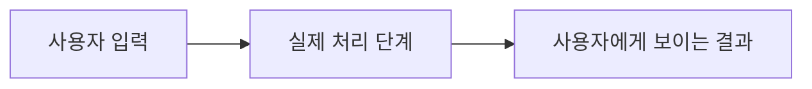

# 결과물 학습 가이드 (STUDY GUIDE)

> S6 검증과 코드 수정을 마친 뒤 작성한다. 과제 안내에서 제출을 허용하는지 먼저 확인한다.
> 생성 기준 커밋: ___  /  작성 시각: ___

## 1. 한눈에 보기
- 해결하는 문제:
- 사용자가 얻는 결과:
- 핵심 흐름 한 줄:

## 2. 요청 하나의 전체 흐름
실제 사용자 동작 하나를 골라 입력부터 결과까지 순서대로 설명한다.

| 순서 | 파일:줄 / 함수 | 입력·처리·출력 |
|---|---|---|
| 1 |  |  |
| 2 |  |  |
| 3 |  |  |

> 실제 코드 흐름에 맞게 노드와 화살표를 수정한다. Mermaid가 부적절하면 간단한 목록으로 대체한다.

## 3. 핵심 코드
| 파일:줄 / 함수 | 역할 | 입력 → 출력 | 기억할 점 |
|---|---|---|---|
|  |  |  |  |
|  |  |  |  |
|  |  |  |  |

## 4. 중요한 설계 결정
`docs/DECISIONS.md`와 실제 코드에 근거해 설명한다. 기록이 없으면 임의로 이유를 만들지 말고 미기록으로 표시한다.

| 결정 | 선택 이유와 대안 | 근거 (파일:줄 또는 기록) |
|---|---|---|
|  |  |  |

## 5. 검증과 한계
- 실행한 테스트·명령과 실제 결과: `docs/VERIFICATION.md`와 일치시킨다.
- 실행하지 않은 항목은 **미검증**으로 표시한다.
- 알려진 약점 → 사용자에게 미치는 영향 → 다음에 확인할 것:
  - (작성)

## 6. 예상 구두 질문과 답
각 답은 3문장 이내로 쓰고, 설명 근거가 되는 파일·함수를 붙인다. 확인할 근거가 없으면 미확인으로 표시한다.

1. 사용자의 요청 하나는 입력부터 결과까지 어떤 순서로 처리되는가?
   - 답:
2. 핵심 함수 세 개는 각각 어떤 역할을 하는가?
   - 답:
3. 입력 검증과 오류 처리는 어디서 이뤄지는가?
   - 답:
4. 가장 중요한 설계 결정은 무엇이며 대안보다 나은 점은 무엇인가?
   - 답:
5. 어떤 상황에서 알려진 약점이 드러날 수 있는가?
   - 답:
6. 성공 기준을 어떤 명령이나 증거로 확인했는가?
   - 답:

## 7. 스스로 설명하기
- [ ] 가이드를 덮고 핵심 사용자 흐름을 파일·함수 이름을 들어 설명할 수 있다.
- [ ] 핵심 함수 세 개의 입력과 출력을 설명할 수 있다.
- [ ] 검증된 부분과 미검증·알려진 한계를 구분해 설명할 수 있다.
